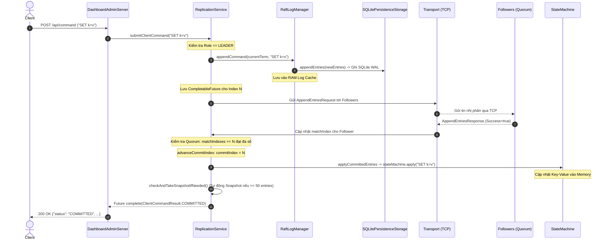

# VAFT - Tài liệu Kiến trúc Hệ thống (System Architecture Document)

Tài liệu này mô tả chi tiết kiến trúc nội bộ, mô hình mạng, định dạng gói tin nhị phân, cơ chế lưu trữ bền vững với SQLite WAL, và các luồng xử lý đồng thuận của hệ thống **VAFT**.

---

## 1. Mô hình Trạng thái Node (Raft State Transitions)

Mỗi node trong cụm tại một thời điểm luôn ở một trong ba vai trò (**`NodeRole`**):

```text
                       [Khởi động / Khởi tạo Node]
                                    │
                                    ▼
                          ┌──────────────────┐
        ┌────────────────►│     FOLLOWER     │◄─────────────────┐
        │                 └─────────┬────────┘                  │
        │                           │                           │
        │                           │ Hết Election Timeout      │
        │ Nhận Term cao hơn         │ (Không nhận Heartbeat)    │ Nhận Term cao hơn
        │ hoặc phát hiện Leader mới ▼                           │ từ Leader khác
        │                 ┌──────────────────┐                  │
        ├─────────────────┤    CANDIDATE     │                  │
        │                 └─────────┬────────┘                  │
        │                           │                           │
        │                           │ Nhận đa số phiếu          │
        │                           │ (Quorum >= N/2 + 1)       │
        │                           ▼                           │
        │                 ┌──────────────────┐                  │
        └─────────────────┤      LEADER      ├──────────────────┘
                          └──────────────────┘
```

### Các quy tắc chuyển đổi vai trò (Invariants):
1. **Follower -> Candidate:**
   * Khi bộ đếm ngẫu nhiên (`ElectionTimeout`: từ 400ms đến 900ms) hết hạn mà không nhận được Heartbeat từ Leader hợp lệ.
   * Node tăng `currentTerm` lên 1, tự bỏ phiếu cho chính mình (`votedFor = selfId`), và gửi RPC `RequestVote` tới tất cả các node khác.
2. **Candidate -> Leader:**
   * Khi thu thập đủ số phiếu bầu đồng thuận đa số (Quorum: $N/2 + 1$).
   * Bắt đầu gửi ngay RPC `AppendEntries` rỗng (Heartbeat) định kỳ mỗi 150ms để duy trì quyền lực và ức chế các đợt bầu cử khác.
3. **Leader/Candidate -> Follower:**
   * Bất kỳ khi nào nhận được một RPC hoặc Response có `term > currentTerm`, node lập tức cập nhật `currentTerm` mới và giáng cấp về `FOLLOWER`.

---

## 2. Giao thức Tầng Mạng (Custom Binary Protocol)

Thay vì sử dụng các giao thức cồng kềnh như HTTP/1.1 hoặc Java Native Serialization, VAFT sử dụng **giao thức nhị phân thuần trên nền TCP Socket** thông qua lớp [`PacketCodec`](file:///Users/ductuan/PBL4-new/vaft/src/main/java/vaft/transport/PacketCodec.java).

### 2.1. Cấu trúc Khung Gói Tin Chung (Packet Header)
Mọi gói tin truyền qua cổng Raft TCP đều bắt đầu bằng một Header cố định:

```text
 0                   1                   2                   3
 0 1 2 3 4 5 6 7 8 9 0 1 2 3 4 5 6 7 8 9 0 1 2 3 4 5 6 7 8 9 0 1
+-+-+-+-+-+-+-+-+-+-+-+-+-+-+-+-+-+-+-+-+-+-+-+-+-+-+-+-+-+-+-+-+
|          MAGIC (0x5641)       |  Type (1 byte)|               |
+-+-+-+-+-+-+-+-+-+-+-+-+-+-+-+-+-+-+-+-+-+-+-+-+               +
|                          Sender ID (4 bytes)                  |
+-+-+-+-+-+-+-+-+-+-+-+-+-+-+-+-+-+-+-+-+-+-+-+-+-+-+-+-+-+-+-+-+
|                         Receiver ID (4 bytes)                 |
+-+-+-+-+-+-+-+-+-+-+-+-+-+-+-+-+-+-+-+-+-+-+-+-+-+-+-+-+-+-+-+-+
|                        PAYLOAD DATA ...                       |
+-+-+-+-+-+-+-+-+-+-+-+-+-+-+-+-+-+-+-+-+-+-+-+-+-+-+-+-+-+-+-+-+
```

* **Magic Number (2 bytes):** `0x5641` (Ký tự ASCII `"VA"` - Định danh giao thức VAFT). Giúp phòng thủ, từ chối ngay các kết nối rác.
* **Message Type (1 byte):**
  * `0`: `REQUEST_VOTE_REQ`
  * `1`: `REQUEST_VOTE_RES`
  * `2`: `APPEND_ENTRIES_REQ`
  * `3`: `APPEND_ENTRIES_RES`
* **Sender ID (4 bytes):** Node ID gửi bản tin.
* **Receiver ID (4 bytes):** Node ID nhận bản tin.

### 2.2. Chi tiết Payload từng loại Bản tin

#### `REQUEST_VOTE_REQ` (Bầu cử):
```text
[Term: 4B] [CandidateId: 4B] [LastLogIndex: 4B] [LastLogTerm: 4B]
```
* Follower chỉ bỏ phiếu đồng ý (`voteGranted = true`) nếu:
  1. `req.term >= currentTerm` và node chưa bỏ phiếu cho ai khác trong term này (`votedFor == null || votedFor == candidateId`).
  2. Log của ứng viên **ít nhất phải mới bằng** log của Follower (`isCandidateLogUpToDate`).

#### `REQUEST_VOTE_RES` (Kết quả bỏ phiếu):
```text
[Term: 4B] [VoteGranted: 1B (boolean)]
```

#### `APPEND_ENTRIES_REQ` (Nhân bản Log / Heartbeat):
```text
[Term: 4B] [LeaderId: 4B] [PrevLogIndex: 4B] [PrevLogTerm: 4B] [LeaderCommit: 4B]
[EntriesCount: 4B]
  ├── Entry 1: [Index: 4B] [Term: 4B] [CommandLength: 2B] [CommandUTF: NB]
  └── ...
```

#### `APPEND_ENTRIES_RES` (Phản hồi Log):
```text
[Term: 4B] [Success: 1B (boolean)] [MatchIndex: 4B]
```

---

## 3. Luồng Xử Lý Dữ Liệu (Read/Write Data Lifecycle)

### 3.1. Luồng Ghi (Write Path) - Quorum Consensus



### 3.2. Luồng Đọc (Read Path) - Trực tiếp từ Leader
* Khi nhận lệnh `GET`, `KEYS`, hoặc `EXISTS`, Leader nhận diện qua `parsedCmd.type().isReadOnly()`.
* **Bỏ qua toàn bộ** các bước ghi log, nhân bản mạng và tính Quorum.
* Đọc trực tiếp từ `ConcurrentHashMap` của `StateMachine` và trả về ngay lập tức.
* **Đảm bảo:** `lastLogIndex` không tăng, ổ đĩa và mạng không bị nghẽn bởi các truy vấn đọc.

---

## 4. Mô hình Đa luồng & Đồng bộ hóa (Concurrency Architecture)

Để đảm bảo thông lượng cao và tránh tranh chấp tài nguyên (Race Conditions):

1. **`RaftState` Lock Scope:**
   * Sử dụng cơ chế `withLock(Runnable)` / `withLock(Supplier)` bọc quanh `ReentrantLock`. Mọi thay đổi về `role`, `currentTerm`, `commitIndex`, và `votedFor` đều được bảo vệ trong khối khóa đồng bộ.

2. **Tách biệt các Thread Pools:**
   * **`Virtual Threads` (Java 21):** Dùng riêng cho `DashboardAdminServer` HTTP Server, mỗi request client được xử lý bởi một lightweight virtual thread, không lo cạn kiệt pool luồng.
   * **`rpcExecutor` (Fixed Thread Pool 4 threads):** Dùng để xử lý việc gửi/nhận socket RPC không đồng bộ với các node ngang hàng.
   * **`scheduler` (Scheduled Thread Pool 2 threads):** Chịu trách nhiệm đếm nhịp Heartbeat định kỳ và kiểm tra Election Timeout.

3. **In-Flight Task Throttle (Chống bão task):**
   * Trong `ReplicationServiceImpl`, sử dụng `Set<Integer> replicatingPeers` để đảm bảo: tại một thời điểm, Leader chỉ có tối đa **1 tiến trình gửi log đang chạy** tới mỗi Follower, ngăn chặn tràn hàng đợi thread khi mạng bị nghẽn.

---

## 5. Bảng Phân vùng Mạng (Chaos NetworkPartitionTable)

Để phục vụ kiểm thử chịu lỗi (Fault Injection):
* Lớp [`NetworkPartitionTable`](file:///Users/ductuan/PBL4-new/vaft/src/main/java/vaft/transport/NetworkPartitionTable.java) quản lý ma trận chặn luồng mạng hai chiều giữa các node.
* Khi gọi `isolateNode(selfId)`, socket transport của node sẽ giả lập ngắt toàn bộ liên lạc:
  * Không gửi bất kỳ RPC nào ra ngoài.
  * Lặng lẽ hủy bỏ (drop) mọi gói tin từ các node khác gửi tới mà không hồi đáp.
  * Giúp kiểm chứng thuật toán bầu Leader mới trên các node còn lại mà không cần tắt container vật lý.

---

## 6. Tầng Lưu Trữ Bền Vững SQLite & Cơ Chế Snapshotting (Persistence & Storage)

Hệ thống triển khai cơ chế lưu trữ bền vững tuân thủ chuẩn Raft Paper (Figure 2) thông qua lớp [`SQLitePersistenceStorage`](file:///Users/ductuan/PBL4-new/vaft/src/main/java/vaft/storage/impl/SQLitePersistenceStorage.java), lưu trữ trong file `data/node-<id>.db`.

### 6.1. Cấu trúc Bảng SQLite (Database Schema)

```sql
-- 1. Quản lý Nhiệm kỳ & Phiếu bầu
CREATE TABLE IF NOT EXISTS raft_meta (
    id INTEGER PRIMARY KEY CHECK (id = 1),
    current_term INTEGER NOT NULL,
    voted_for INTEGER NOT NULL
);

-- 2. Write-Ahead Log (WAL)
CREATE TABLE IF NOT EXISTS raft_log (
    log_index INTEGER PRIMARY KEY,
    term INTEGER NOT NULL,
    command TEXT
);

-- 3. Metadata của Snapshot
CREATE TABLE IF NOT EXISTS raft_snapshot_meta (
    id INTEGER PRIMARY KEY CHECK (id = 1),
    last_included_index INTEGER NOT NULL,
    last_included_term INTEGER NOT NULL
);

-- 4. Bản chụp Key-Value của State Machine
CREATE TABLE IF NOT EXISTS raft_snapshot_kv (
    k TEXT PRIMARY KEY,
    v TEXT
);
```

### 6.2. Tối ưu hóa SQLite ở Tầng Hệ Điều Hành
* `PRAGMA journal_mode = WAL;`: Kích hoạt chế độ **Write-Ahead Logging** của SQLite. Đọc và ghi diễn ra đồng thời không khóa nhau, chuyển đổi ngẫu nhiên thành ghi tuần tự xuống file `raft.db-wal`.
* `PRAGMA synchronous = NORMAL;`: Tối ưu hóa số lần gọi `fsync()`, vừa đảm bảo an toàn nếu ứng dụng crash vừa tăng tốc độ commit log.
* **Batch Transactions:** Ghi log số lượng lớn (`appendEntries`) được bọc trong một Database Transaction duy nhất (`setAutoCommit(false)` -> `executeBatch()` -> `commit()`), nếu lỗi sẽ tự động `rollback()`.

### 6.3. Cơ chế Tự Động Snapshotting (Log Compaction)
* **Nguyên lý kích hoạt:** Trong `ReplicationServiceImpl`, sau mỗi lần apply log vào `StateMachine`, hàm `checkAndTakeSnapshotIfNeeded()` sẽ kiểm tra:
  $$\text{lastApplied} - \text{lastSnapshotIndex} \ge \text{snapshotThresholdEntries}$$
  (Mặc định ngưỡng là **50 log entries**, cấu hình trong `cluster.yaml`).
* **Quy trình chụp Snapshot:**
  1. Lấy `lastIncludedIndex = lastApplied` và `lastIncludedTerm = logManager.getTermAt(snapIdx)`.
  2. Lấy toàn bộ cặp key-value từ `stateMachine.getSnapshotData()`.
  3. Mở transaction SQLite: cập nhật `raft_snapshot_meta`, xóa bảng `raft_snapshot_kv` cũ và batch insert các cặp key-value mới.
  4. Cập nhật `raftState.setLastSnapshotIndex(snapIdx)`.

### 6.4. Quy trình Khởi động & Khôi phục Sau Sự Cố (Recovery Flow)

Khi một Node khởi động lại (trong [`App.java`](file:///Users/ductuan/PBL4-new/vaft/src/main/java/vaft/App.java#L57-L72)):

```text
[Khởi động Node]
       │
       ▼
1. Mở kết nối SQLite tại data/node-<id>.db (Tự tạo schema nếu chưa có)
       │
       ▼
2. persistentStorage.load()
       ├── Khôi phục currentTerm, votedFor vào RaftState
       └── Khôi phục danh sách LogEntry vào RaftLogManagerImpl (Sentinel index 0 cố định)
       │
       ▼
3. persistentStorage.loadSnapshot()
       ├── Nếu CÓ Snapshot (lastIncludedIndex > 0):
       │     ├── stateMachine.restoreSnapshotData(recoveredSnapshot.data())
       │     ├── raftState.setLastSnapshotIndex(lastIncludedIndex)
       │     ├── raftState.setLastApplied(lastIncludedIndex)
       │     └── raftState.setCommitIndex(lastIncludedIndex)
       └── Nếu KHÔNG có Snapshot: Khởi tạo StateMachine rỗng
       │
       ▼
4. [Hoàn tất] Node sẵn sàng gia nhập cụm với dữ liệu nguyên vẹn!
```
